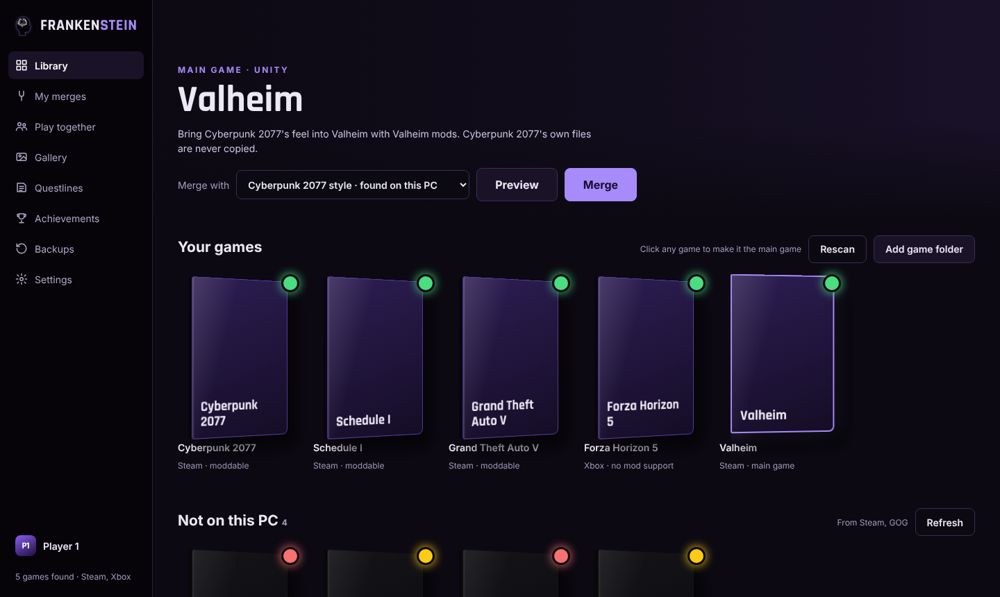

# Frankenstein

**Download: [FrankensteinSetup.exe](https://github.com/LKZ007/game-merger/releases/latest/download/FrankensteinSetup.exe)** (Windows 10/11, free)

A Windows game launcher that "merges" games the realistic way. You pick a base game you
actually play, pick the style of another game to bring in, and Frankenstein makes a safe
copy, installs the mod frameworks, and installs the mods you choose. **Franklin**, the
built-in AI assistant, explains the merge, finds mods, checks them for clashes and reads crash logs.

## Features

- **One-click merges**: safe copy of the game (fast copy uses almost no extra space), mod frameworks downloaded for you, undo any time.
- **Franklin**: AI assistant on Claude with a voice. Explains merges, suggests and checks mods, reads crash logs, fixes crashes in one click, remembers what you like.
- **Nexus Mods inside the app**: search and download mods straight into a merge (needs your Nexus API key).
- **Own saves per merge**, with optional cloud backup to OneDrive or Google Drive.
- **Mod profiles** (chill / chaos), **Defender scan** of every mod, **online-safety lock** for GTA V.
- **Play together**: a private network for you and your friends, like Hamachi (built on ZeroTier).
- **Share a merge** as a `.gmerge` file your friend double-clicks.
- **Gallery**: Ctrl+Alt+S screenshots plus Game Bar clips.
- **Every game you own**: connect Steam, Epic and GOG to see games that aren't installed here, and which ones are on your other PC.
- **Fun rating**: green / yellow / red colour code on every game for how fun it'd be to merge into the one you picked.
- **Preview before merging**: streamed trailers and mod pictures with Franklin's pitch, nothing downloaded.
- **Borderless full screen** launcher (F11 or Esc for a window), dark violet look, auto-updates.

## What it can merge right now

| Base game | Merge with |
|---|---|
| Cyberpunk 2077 | Forza style (cars, handling, racing), GTA style (police, traffic, radio) |
| Schedule I | Hood Warfare style (guns, gang fights), GTA style |
| GTA V (Story Mode only) | Minecraft style (skins, mobs, building) |

No files are ever copied out of the "merged with" game. Different engines can't share files,
and copying them would break those games' terms.

## Getting started

1. Download **FrankensteinSetup.exe** from the latest release:
   https://github.com/LKZ007/game-merger/releases/latest
2. Double-click it and press **Install**. No admin prompt, no Python. You get a desktop
   shortcut and a Start menu entry; right-click either and choose **Pin to taskbar**.
3. The first time it opens, Franklin asks once for Windows permission to change your game
   folders. Press **Sort it**, then **Yes**. You won't be asked again.
4. Updates install themselves: when a new version is out, Franklin offers it and one click
   updates the app. Your merges, saves and settings are never touched.

Windows may show "Windows protected your PC" because the installer isn't signed. Click
**More info**, then **Run anyway**. For `.7z` and `.rar` mods, install 7-Zip from https://www.7-zip.org.

**If Windows Defender blocks or quarantines it:** that's a false positive. Small unsigned apps
built with Python and PyInstaller get flagged by Defender's machine-learning check
(names like `Trojan:Win32/Bearfoos.A!ml` or `Wacatac`). From 3.4.0 the app is built with its own
compiled launcher, which avoids most of these. If it still happens:
1. Open **Windows Security > Virus & threat protection > Protection history**, pick the item and
   choose **Restore**.
2. Report it to Microsoft so it's fixed for everyone: https://www.microsoft.com/en-us/wdsi/filesubmission
   (choose "Software developer" or "Home customer", "Incorrectly detected as malware").

Code signing would remove the warnings completely. Free signing for open-source projects is
available from SignPath Foundation (https://signpath.org), which needs an application.

Uninstall from **Settings > Apps**. Your merged copies, their saves and your settings
(in `%LOCALAPPDATA%\GameMerger`) are kept.

## Setting up Franklin

Franklin runs on Claude with your own Anthropic API key:

1. Create a key at https://console.anthropic.com (add a little credit; most questions cost a few cents).
2. In Frankenstein, open **Settings** and paste the key.

Franklin sees only game names, mod file names, the paths inside your mods, and log files.
It never uploads your game files. The key is stored on your PC only, in
`%LOCALAPPDATA%\GameMerger\settings.json`.

## Franklin's voice

Franklin talks with a free, natural-sounding voice: a warm, smooth radio-host style by default
(Andrew, Brian, Christopher or Roger, pick in Settings), with a mute button at the top of his
panel. Offline, he falls back to the voice built into Windows. If you've made your own cloned
voice with XTTS on this PC, it shows up in Settings too. An ElevenLabs key is optional.

## How to use it

1. **Library**: your games from Steam, Epic, GOG and the Xbox app are shown as 3D boxes.
   Click a game with a glowing edge to make it the base game, choose **Merge with**, then **Merge**.
2. **Mod frameworks** download automatically.
3. **Mods**: click **Find mods** (opens Nexus Mods), download what you like, then **Add file**.
   Frankenstein shows where each mod goes and warns you when two mods clash.
4. **Where to put it**: Fast copy (default, almost no extra space), Full copy, or Mod the original (with backups).
5. **Own saves**: every merge gets its own save games. When you press Play they're swapped in,
   and your normal saves come back when the game closes.
6. **My merges**: Play, Add mods, Why did it crash? (Franklin reads the logs), Undo all mods, Delete.
7. **Backups**: restore any original install you modded directly.

## Sharing a merge

In **My merges**, press **Share**. Frankenstein saves a `.gmerge` file in your Downloads folder
with the mods in it (never the game itself). Your friend double-clicks it and gets the same
merge built from their own copy of the game, with its own saves.

## Repository layout

| Folder | What's in it |
|---|---|
| `gamemerger/` | The app (Python). `api.py` is everything the UI can call; `franklin.py`, `voice.py`, `nexus.py`, `network.py`, `installer.py` (merges and undo), `saves.py`, `updater.py` |
| `gamemerger/web/` | The UI (HTML, CSS, JS) shown in the app window |
| `gamemerger/recipes/` | One JSON recipe per base game: frameworks, styles, where mods go |
| `installer/` | NSIS installer script, icon and art, release notes for the next release |
| `tests/` | Unit tests |
| `docs/` | Screenshots for this page |
| `.github/workflows/release.yml` | Builds the installer on Windows and publishes a release |

The `gamemerger` folder keeps its old name on purpose: the app was called Game Merger before 3.8.0,
and renaming the package would break installed copies and their data folder.

## For developers

- Run from source: `pip install -r requirements.txt`, then `Run Frankenstein.bat` (or `python Frankenstein.pyw`; add `--browser` to open it in a browser).
- Tests: `python -m unittest discover -s tests`.
- Local build: `Build exe.bat` makes `dist\Frankenstein\Frankenstein.exe`; then
  `makensis -DVER=x.y.z installer\Frankenstein.nsi` makes `dist\FrankensteinSetup.exe`.
- **Releasing**: bump `gamemerger/version.py`, write `installer/release-notes.md`, add the notes to
  `CHANGELOG.md`, and push to `main`. The workflow builds the installer and publishes release `vX.Y.Z`
  with two copies of it: `FrankensteinSetup.exe`, and `GameMergerSetup.exe` for installs from before
  the rename (their updater looks for that name). Installed apps offer the update on their next start.
- Add a base game by dropping a recipe `.json` (same format as `gamemerger\recipes`) into
  `%LOCALAPPDATA%\GameMerger\recipes`.

## Licences and credits

Frankenstein uses, downloads or works with these projects, each under its own licence:

- [pywebview](https://github.com/r0x0r/pywebview) (BSD-3-Clause) for the app window, on Microsoft Edge WebView2.
- [edge-tts](https://github.com/rany2/edge-tts) (LGPL-3.0) for Franklin's free voice, using Microsoft's online voices.
- **Coqui XTTS v2**, only if you set up your own cloned voice: the model is under the
  [Coqui Public Model License (CPML)](https://coqui.ai/cpml), which allows **non-commercial use only**.
  It isn't bundled; it runs from your own install, and Frankenstein only starts it when you pick it in Settings.
- [ZeroTier One](https://www.zerotier.com/) for Play together, downloaded from ZeroTier when you set it up (ZeroTier's own licence).
- [Anthropic Claude API](https://www.anthropic.com/) for Franklin, with your own API key; [Nexus Mods API](https://www.nexusmods.com/) with your own key.
- [Pillow](https://python-pillow.org/), [icoextract](https://github.com/jlu5/icoextract), [PyInstaller](https://pyinstaller.org/) (GPL with the bootloader exception) and [NSIS](https://nsis.sourceforge.io/) (zlib) to build it.

Mods, frameworks and games belong to their authors and publishers. Frankenstein never copies files
out of the game whose style you merge in.
